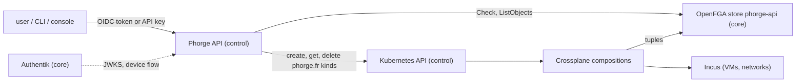

# Building the Phorge API: guide for the implementer

Written for an engineer or coding agent who starts the Phorge API from scratch. Read [phorge-api.md](phorge-api.md) first: it describes the `phorge.fr` kinds the API manages. This page says what to build around them, in what order, and what the platform has already shown it does.

## 1. What you are building

A REST API that lets authenticated users and API keys manage tenants and their VMs. It does **not** talk to Incus to create anything: it creates, reads and deletes Kubernetes objects of the `phorge.fr/v1alpha1` group (`Tenant`, `Image`, `Instance`, `Membership`, `ApiKey`) on the `control` cluster. Crossplane turns them into Incus and OpenFGA objects. The XRDs in `overlays/control/controllers/crossplane/` are the contract.



Decisions already taken:

| Question | Decision |
|---|---|
| Where it runs | The `control` cluster, namespace `phorge-api` |
| Language | Go |
| Repository | Its own repository in the `phorge-fr` organization. Hangar keeps only the deployment manifests |
| Groups in v1 | **Users only.** A `Membership` of kind `Group` is refused by the API: nobody writes `user member group` tuples today |
| Direct Incus access | Read-only for every user (UI at `iaas.phorge.fr`). Writing goes through this API, nowhere else |

Not in v1: groups, `Expose` (publishing an instance), volumes, snapshots, ACLs, metering, the console itself.

## 2. What is already in place

| Piece | Where | Status |
|---|---|---|
| The five kinds and their compositions | `overlays/control/controllers/crossplane/` | Deployed and covered by `tests/e2e/` |
| OIDC application "Phorge" | `overlays/core/apps/authentik/blueprint-phorge-api.yml` | Deployed. Issuer `https://auth.phorge.fr/application/o/phorge/`, audience (client id) `49a1375b-c52a-4a59-b3cb-8d4f5e392d85`, public client |
| ServiceAccount `phorge-api` with limited RBAC | `overlays/control/apps/phorge-api/rbac.yml` | Deployed. Can manage the five kinds, nothing else (no namespaces, no Secrets, no update on `Membership`) |
| OpenFGA | `https://openfga.core.phorge` (inside the network), stores `iaas` and `phorge-api` | Deployed |
| The internal CA, as a ConfigMap | `phorge-api-ca` (key `ca.crt`), namespace `phorge-api` on `control` | Deployed. `openfga.core.phorge` is signed by the cert-manager CA `local-root-ca`, which a pod does not trust by default (`ssl_verify=20`). Mount this ConfigMap and add it to the trusted roots; never turn verification off. `auth.phorge.fr` has a public certificate and needs nothing |
| A dedicated OpenFGA key | Secret `phorge-api-openfga`, key `apiKey`, namespace `phorge-api` on `control` | Deployed. Not scoped: any key can read and write every store |
| Network path `control` to `core` | Router rule `alloy-ctrl-to-core` (TCP 443 to `10.2.0.10`) | Works: OpenFGA answers 200 from a pod of `control` |
| Authentik from `control` | `auth.phorge.fr` | Works through the public address (NAT hairpin of the ISP box). Fragile, keep the issuer URL configurable |

Store ids (not secret): `iaas` `01M46QWWZKD17137T1AB0V6V0Q`, `phorge-api` `01M50R0P12MY8JHNKP3ATYSJC2`. The API only uses `phorge-api`.

Decided: the API is published at `api.phorge.fr` (a new host needs no change in the Network repository: the edge HAProxy sends every host it does not know to the control ingress, only its public DNS record is needed), its image is `ghcr.io/phorge-fr/phorge-api` (built and published by the CI of the `phorge-api` repository, public), and the platform administrators who create tenants are the members of the Authentik group `phorge-platform-admins` (`PLATFORM_ADMIN_GROUP`, read from the `groups` claim of the token).

Still to decide with the owner (do not guess, ask): the public host name of the console.

## 3. Working on the platform from your machine

You need the `kubectl` contexts `control` and `core` (ask the owner if missing).

```bash
# OpenFGA from your machine (the .phorge names are internal)
kubectl --context core -n openfga port-forward svc/openfga 18080:8080 &

# its key, without printing it
export FGA_TOKEN=$(kubectl --context control -n phorge-api get secret phorge-api-openfga -o jsonpath='{.data.apiKey}' | base64 -d)
export FGA_URL=http://127.0.0.1:18080
curl -s -H "Authorization: Bearer $FGA_TOKEN" $FGA_URL/stores | jq '.stores[].name'

# an access token as a user: device code flow against the Phorge application
curl -s https://auth.phorge.fr/application/o/device/ -d client_id=49a1375b-c52a-4a59-b3cb-8d4f5e392d85 -d 'scope=openid email profile offline_access'
# open the verification_uri_complete, sign in, then poll https://auth.phorge.fr/application/o/token/
#   with grant_type=urn:ietf:params:oauth:grant-type:device_code, device_code=..., client_id=...
```

From a pod the URL is `https://openfga.core.phorge` with the CA above; from your machine use the port-forward (plain HTTP on `127.0.0.1`), the `.phorge` names do not resolve there. Never print, log or commit a key or a token. Never put a secret in a file that is not SOPS-encrypted (`age.agekey` at the root of Hangar decrypts; the rules are in `.sops.yaml`).

The platform has an end-to-end suite you can run to check it is healthy before and after your work: `tests/e2e/run.sh fast` (a few minutes, no VM), the whole suite takes about an hour. Read `tests/e2e/README.md`. It creates tenants named `e2e-*`; **name yours differently** (`apitest-<run>-*`) so that its cleanup never touches your data and yours never touches its.

Do not change an XRD, a composition or anything under `overlays/` on the cluster by hand: open a pull request on Hangar. Flux reverts live changes.

## 4. The API

### 4.1 Authentication

Two kinds of caller, both in the `Authorization: Bearer ...` header.

- **A user token** (JWT from Authentik): verify the signature against the JWKS of the issuer, the issuer, the audience (the client id above), the expiry. The user is the **`email` claim**, exactly as it is, case included: it is the key of every OpenFGA tuple (`user:<email>`). Refuse a token without a verified email.
- **An API key** is personal: `phk_<id>_<secret>` (hex), where the id is the name of the `ApiKey` object of the namespace `phorge-keys`, so the object is found with one `get`. Compare `sha256(secret)` (hex) with `spec.hash` in constant time. Refuse it when `status.expired` is true, `spec.expiresAt` has passed (check both), the object is being deleted or has no `spec.owner`. The caller it stands for is `spec.owner`, limited to `spec.scopes`.

### 4.2 Authorization

Every request is a `Check` in the `phorge-api` store on the object `tenant:<name>`:

| Caller | User of the tuple | Example |
|---|---|---|
| user | `user:<email>` | `Check(user:alice@example.org, can_write_instances, tenant:demo)` |
| key | `user:<owner>`, after the scope was checked | `Check(user:alice@example.org, can_write_instances, tenant:demo)` |

| Action | Relation to check |
|---|---|
| read the tenant | `can_read_tenant` |
| list or read instances; images | `can_read_instances`; `can_read_images` |
| create, patch (start/stop), delete an instance | `can_write_instances` |
| create, delete an image | `can_write_images` |
| list or read memberships and keys | `can_read_memberships` |
| create or delete a membership or a key | `can_write_memberships` |

The model is in `overlays/control/controllers/crossplane/openfga-phorge-model.yml`. User roles `admin` ⊃ `operator` ⊃ `user` ⊃ `viewer`; a key only has the scopes it was given.

Rules that are yours to enforce, nothing below does it:

- A key never exceeds its creator: to create a key, check that the caller holds the right behind **each** requested scope (`instances:write` needs `can_write_instances`, and so on). A key can only create keys if it has `memberships:write`, with a subset of its own scopes.
- Tenants a user can see: `ListObjects(user:<email>, can_read_tenant, tenant)`.
- The model has no relation for creating, resizing or deleting a **tenant**. In v1 those are reserved to a list of platform administrators (emails) read from the configuration. Do not change the model for this without asking: a model is immutable and versioned.

### 4.3 Resources

Suggested routes; the shape is yours as long as it maps one to one on the kinds.

| Route | Kind | Notes |
|---|---|---|
| `/v1/tenants`, `/v1/tenants/{t}` | `Tenant` in `phorge-system` | Create: platform admins only. `owner` and the name cannot change. `plan` and `displayName` can be patched |
| `/v1/tenants/{t}/images`, `.../{name}` | `Image` in `t-{t}` | Source name and remote are free, but only `type: virtual-machine` exists. Pulling takes minutes |
| `/v1/tenants/{t}/instances`, `.../{name}` | `Instance` in `t-{t}` | Start/stop is a patch of `spec.running`. The image must be an `Image` of the same tenant |
| `/v1/tenants/{t}/memberships`, `.../{name}` | `Membership` in `t-{t}` | `User` subjects only. No update |
| `/v1/apikeys`, `.../{id}` | `ApiKey` in `phorge-keys` | See 4.4 |

The slug rules are in the XRDs (a tenant name is 2 to 28 lowercase letters, digits and hyphens, starting with a letter): validate before sending, the API server rejects the rest anyway.

Everything is **asynchronous**. Creating a `Tenant` takes about a minute, an `Image` several minutes, an `Instance` about a minute once its image exists. Return `202` with the object and let the client poll. Map the state like this:

- `Ready=True`: done.
- `Ready=False`: in progress, **unless** `status.problems` is not empty for a while: then it is an error and `problems` is its message (the Incus or OpenFGA error, for instance `Alias 'x' doesn't exist`). Show it as is.
- `Synced=False` on the object with a message naming a namespace (`has no Tenant`, `belongs in ...`) is a client error.

### 4.4 API keys

- The API generates the id and the secret (32 random bytes in hex), stores only `sha256` hex in `spec.hash`, records the caller in `spec.owner`, and returns the full key **once**.
- A key is its owner, limited to its scopes: check the scope, then `Check(user:<owner>, ...)`. Nothing is written to OpenFGA for a key, and nothing needs removing when it expires or is deleted.
- `spec.scopes` is a set among `tenants:read|write`, `instances:read|write`, `images:read|write`, `memberships:read|write`. `tenants:write` creates, resizes and deletes tenants and needs a platform administrator; the others need what the owner has on the tenant.
- Only a person signed in with Authentik manages keys, never a key. Creating and changing is for the platform administrators for now (the Authentik group `phorge-platform-admins`); anyone lists and revokes their own, and someone else's key is a `404`. A key has to expire (at most 366 days).
- A token carries the groups of its user, a key does not: for a key, ask Authentik whether the owner is a member of `phorge-platform-admins`, with the token of the service account `phorge-api-directory` (Secret `phorge-api-authentik`, env `AUTHENTIK_TOKEN`, `AUTHENTIK_URL`), and refuse (503) when it cannot be asked. The token can read that one group and nothing else.

**The service account is in a blueprint, with nothing to do by hand.** `blueprint-phorge-api.yml` creates the user `phorge-api-directory` (a service account), a role, a group, its token, and gives the role the right to read the group `phorge-platform-admins` (an object permission, which is all a blueprint can grant; the members of that group stay managed in Authentik). The key of the token is one value, in two SOPS secrets that are both used: `authentik-phorge-api-directory` (namespace `authentik` on `core`, read by authentik through `PHORGE_API_DIRECTORY_TOKEN`, which the blueprint reads with `!Env`) and `phorge-api-authentik` (namespace `phorge-api` on `control`, which the Deployment passes as `AUTHENTIK_TOKEN`). To rotate it, put a new value in both: the blueprint updates the token, the pods pick the secret up at their next restart.

## 5. What the platform does, learned the hard way

These are measured behaviours (see `tests/e2e/` and the issues). Build around them, do not hide them.

1. **Delete in the foreground.** Send `propagationPolicy: Foreground`. In the default mode a `Tenant` object is gone after 1 to 2 seconds while its resources and the Incus project last 20 to 60 seconds; in the foreground it stays until everything is gone (about 2 minutes for a tenant with a running VM). Treat "not found" as "deleted". Deleting a `Membership` still leaves its OpenFGA tuples for up to about a minute (9 to 55 seconds measured): permissions are not revoked instantly. If you need an instant cutoff, also check `deletionTimestamp`. A key has no tuple: it stops as soon as its object is deleting.
2. **A `Membership` cannot be edited.** A tuple cannot be changed in place; the XRD refuses the edit. To change a role: delete, wait until it is gone, create. There is **one `Membership` per user per tenant**; a second one is not composed (`Ready=False`). The owner of a tenant has `admin` from the `Tenant` itself and cannot be given a `Membership`; to hand a tenant over, give the new person `admin`.
3. **An `Image` that a VM uses cannot be deleted.** An admission webhook refuses the delete with "in-use by 1 usage(s)" (check the status code you actually get, do not rely on a particular one) and the API should answer `409 Conflict`. The refusal is remembered: when the last VM goes, the image goes by itself a few seconds later.
4. **An `Instance` whose first start failed is stuck.** The provider keeps it as failed and refuses to destroy it. The only way out is to delete the `Instance` and create it again. The usual cause is an image that does not boot with secure boot (`alpine/3.22/cloud`): set `spec.secureBoot: false`. `status.problems` shows both errors.
5. **Quotas are Incus's.** A plan limits VMs, CPU, memory, disk and networks per tenant. The refusal comes back in `status.problems` (`Reached maximum number of instances`, `Reached maximum aggregate value "100GiB" for "limits.disk"`), not as an error of your request: surface it. Stopped VMs count.
6. **A VM deleted directly in Incus is recreated blank** by Crossplane. This is why Incus is read-only.
7. **A tenant network subnet is chosen by Incus.** The provider does not return it, so the API cannot see it from Kubernetes. It could, in rare cases, fall in one of the router's VLANs (`10.1` to `10.5`, `10.10` to `10.12`); reading it from Incus after the tenant is `Ready` would need an Incus client certificate and a firewall rule from `control` to the Incus nodes. Out of scope for v1, keep it in mind.
8. `Image` has `spec.source.remote` (default `images`, i.e. linuxcontainers.org), `name` (for example `debian/13/cloud`), `architecture` (default `x86_64`, the compute nodes'). Use a `cloud` image if the VM must accept `spec.sshPublicKeys`.

## 6. Order of work

Each step ends with tests you ran, not only written. Open a pull request per step.

| Step | Deliverable | Done when |
|---|---|---|
| 0 | Repository, `go.mod`, linter, CI, a `Dockerfile`, health (`/healthz`, `/readyz`) and `/metrics`, JSON logs, configuration from the environment (issuer, audience, OpenFGA URL and key, store id, platform admins) | `make test` and `make build` pass in CI, the image builds |
| 1 | Authentication: JWT validation against the live JWKS, API key lookup and hash check | A real token from the device flow and a hand-made `ApiKey` object both authenticate; an expired or wrong one does not |
| 2 | Authorization: the `Check` and `ListObjects` wrappers, the scope-to-relation table, "a key never exceeds its creator" | Table-driven tests against the real `phorge-api` store with tuples you create and remove |
| 3 | Tenants: list, get, create, patch, delete (foreground) | A tenant created through the API becomes `Ready`, and deleting it leaves nothing in Kubernetes nor in Incus |
| 4 | Images and instances, with `status.problems` surfaced and the quota refusals | A VM boots from an image created through the API and is stopped and started with a patch |
| 5 | Memberships and API keys | A member sees only the tenants and actions their role allows; a personal key acts as its owner within its scopes and stops working at its expiry |
| 6 | Deployment manifests in Hangar (Deployment, Service, Ingress, PodMonitor, NetworkPolicy), the host name, the console redirect URI in the Authentik blueprint | The API runs on `control` and the `tests/e2e/` suite still passes |

For the integration tests, do not mock Kubernetes or OpenFGA where the point is the platform's behaviour: use the real `control` cluster with the `apitest-` tenants and clean up after yourself (children first, then the tenant, then wait until the Incus project is gone). Use fakes for the logic that does not depend on it.

## 7. Rules

- All Phorge repositories: **never add Claude or Anthropic attribution** to a commit message or a pull request. Write issues and pull request descriptions in English. Ask the owner before any `git commit` or `git push`.
- Open issues titled `<cluster>/<subject>: <Description>` (for example `control/phorge-api: ...`).
- A change to the platform (an XRD, a composition, the OpenFGA model, RBAC, a firewall rule) is a pull request on Hangar or the Network repository, never a live edit.
- Do not touch anything that is not yours: projects `ct-poc` and `default` in Incus, tenants you did not create.
- When the contract is unclear, read the XRD and the composition, then the tests in `tests/e2e/`, before asking. When something here contradicts the cluster, the cluster is right: fix this page.
