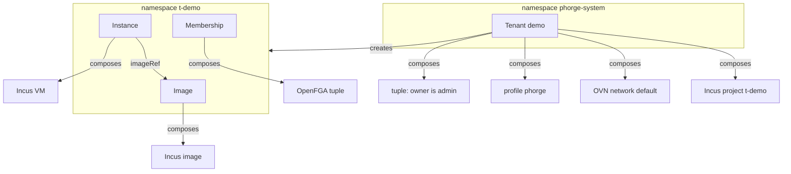

# Phorge API kinds (`phorge.fr/v1alpha1`)

The resources a tenant of the Phorge cloud is made of. They are Crossplane composite resources (XRs) on the `control` cluster. An API, a console or a Terraform provider only has to create, read and delete these; Crossplane turns them into Incus and OpenFGA objects. The schemas are the contract: the source of truth is the XRD in `overlays/control/controllers/crossplane/` (`xrd-*.yml`), this page explains them.

- [Model](#model)
- [Tenant](#tenant)
- [Image](#image)
- [Instance](#instance)
- [Membership](#membership)
- [What a tenant can and cannot do](#what-a-tenant-can-and-cannot-do)
- [Lifecycle and deletion](#lifecycle-and-deletion)
- [Authorization](#authorization)
- [Not done yet](#not-done-yet)

## Model



| Kind | Scope | Lives in |
|---|---|---|
| `Tenant` | Namespaced | `phorge-system` only |
| `Image`, `Instance`, `Membership` | Namespaced | the tenant's namespace `t-<name>` only |

A tenant `demo` is the namespace `t-demo` and the Incus project `t-demo`. Creating an `Image`, `Instance` or `Membership` anywhere else, or a `Tenant` outside `phorge-system`, fails with `Synced=False` and a message that names the namespace. This guard exists because the namespace is used as the Incus project name: an `Instance` in `default` would otherwise target the real `default` project.

Every kind reports the standard Crossplane conditions (`Synced`, `Ready`). `Ready=True` means every composed resource is up.

## Tenant

The isolation and quota boundary. `metadata.name` is the tenant slug: 2 to 28 characters, lowercase letters, digits and hyphens, starting with a letter.

| Field | Type | Rule |
|---|---|---|
| `spec.owner` | string, required, immutable | Email of the owner, the OIDC claim Incus identifies users by. Gets the Incus `admin` role on the project. To hand a tenant over, add a `Membership` with the `admin` role |
| `spec.displayName` | string | Up to 100 characters. Used as the project description |
| `spec.plan` | enum | `small` (default), `medium`, `large` |
| `status.namespace` | string | `t-<name>` |
| `status.incusProject` | string | `t-<name>` |

Plans, enforced by Incus as project limits:

| Plan | VMs | vCPU | Memory | Disk | Networks |
|---|---|---|---|---|---|
| `small` | 1 | 2 | 4 GiB | 20 GiB | 1 |
| `medium` | 3 | 4 | 8 GiB | 100 GiB | 2 |
| `large` | 6 | 8 | 16 GiB | 250 GiB | 3 |

Composes: a Kubernetes namespace, an Incus project, an OVN network `default` of its own on the `UPLINK` (NATed), a profile `phorge` (root disk on the `remote` pool, `eth0` on that network) and the owner's tuple.

```yaml
apiVersion: phorge.fr/v1alpha1
kind: Tenant
metadata:
  name: demo
  namespace: phorge-system
spec:
  owner: alice@example.org
  plan: small
```

## Image

An image pulled into the tenant's project. Instances start from an `Image`, never from a bare image name: an instance created from a remote name makes Incus cache that image in the project outside any managed resource, and the project can then no longer be deleted.

| Field | Type | Rule |
|---|---|---|
| `spec.source.name` | string, required | Name on the remote, e.g. `debian/13/cloud` |
| `spec.source.remote` | string | Default `images` (linuxcontainers.org) |
| `spec.source.type` | enum | `virtual-machine` only (default) |
| `spec.source.architecture` | string | Default `x86_64`, see below |
| `spec.aliases` | list of string | Optional Incus aliases |
| `status.fingerprint` | string | Set once pulled |

The architecture default matters: the Incus provider runs on the arm64 control nodes and Incus otherwise pulls the image for the client's architecture, which no compute node can run. Pulling a VM image takes a few minutes.

## Instance

A virtual machine in the tenant's project.

| Field | Type | Rule |
|---|---|---|
| `spec.imageRef.name` | string, required | An `Image` of the same tenant |
| `spec.cpu` | integer | 1 to 16, default 1 |
| `spec.memoryMiB` | integer | 256 to 65536, default 1024 |
| `spec.diskGiB` | integer | 1 to 500, default 10 |
| `spec.running` | boolean | Default `true` |
| `spec.nesting` | boolean | Default `false`. Allows virtualization or containers inside the VM |
| `spec.sshPublicKeys` | list of string | Injected with cloud-init, so the image must be a `cloud` variant |
| `status.state` | string | Incus state, e.g. `Running` |
| `status.ipv4` | string | Address on the tenant's network |

The per-instance bounds are the XRD's. The plan's totals are enforced on top by the project: a second VM on a `small` tenant is refused by Incus with `Reached maximum number of instances`, and the instance stays `Synced=False` with that message.

## Membership

Gives a user or a group a role on the tenant. The tenant is the namespace the `Membership` lives in.

A `Membership` cannot be edited: changing the subject or the role is refused. An OpenFGA tuple cannot be changed in place and the provider refuses to destroy one, so an edit would leave the old right granted while everything reads `Ready`. Delete the `Membership` and create another.

| Field | Type | Rule |
|---|---|---|
| `spec.subject.kind` | enum, required | `User` or `Group` |
| `spec.subject.name` | string, required | The user's email, or the group name |
| `spec.role` | enum, required | `admin`, `operator`, `user`, `viewer` |

The roles are Incus project roles, written as an OpenFGA tuple in the store Incus authorizes against:

| Role | Meaning |
|---|---|
| `admin` | Everything in the project, including its configuration |
| `operator` | Manage instances, images and networks |
| `user` | Use and create instances |
| `viewer` | Read-only |

## What a tenant can and cannot do

The project is deny-by-default: `restricted=true` and every `restricted.*` key set explicitly, so a changed default in a later Incus release cannot silently open something.

| Allowed | Blocked |
|---|---|
| VMs, with optional nesting | Containers (`limits.containers=0`) |
| Disks on the `remote` pool, managed NICs | GPU, PCI, USB, proxy, infiniband, unix devices |
| Several OVN networks, up to the plan, on the `UPLINK` | Choosing a cluster node (placement is Incus's) |
| Data volumes, snapshots, backups | Forwards and load balancers (no public exposure yet) |
| Images through the `Image` kind | Custom image upload |

Traffic from a tenant leaves through the `comp-ns` VLAN. The router drops traffic between Phorge networks (`drop-phorge-to-phorge` in the Network repository), so tenants reach the Internet but not the other VLANs. That is enforced by the router, not by Incus.

## Lifecycle and deletion

- **Delete in the foreground.** Deleting an XR in the default (background) mode removes the object at once while its composed resources and the Incus objects last for up to a minute or two: a `Tenant` was gone after 1 s, its resources after 58 s. With `propagationPolicy: Foreground` (`kubectl delete --cascade=foreground`) the object stays until everything it composed is gone, so its absence is a real completion signal. An API should always delete this way and treat "not found" as "deleted".
- **An `Instance` whose first start failed is stuck and must be deleted and created again.** Incus creates the VM, the start then fails (for instance "incompatible with secureboot", see `spec.secureBoot`), and the provider keeps the resource as failed: every later reconcile wants to destroy and recreate it, which `prevent_destroy` refuses. `status.problems` then shows the original error as well as the `prevent_destroy` one.
- **An `Image` used by an `Instance` cannot be deleted.** The request is refused ("in-use by 1 usage(s)"). The refusal is remembered and replayed: the `Image` goes by itself, a few seconds after the last `Instance` that uses it, without a second delete.
- `status.problems` on every kind says what is wrong with the composed resources (the Incus or OpenFGA error), empty when everything is up. `Ready` now needs the composed resources to be `Ready` **and** `Synced`.

- Deleting an `Instance` or an `Image` removes the Incus object.
- Deleting a `Tenant` deletes its namespace, which cascades to every `Image`, `Instance` and `Membership` in it, then the network, the profile, the tuple and finally the project. Incus refuses to delete a non-empty project, so the project is retried until its contents are gone. The projects are never force-destroyed.
- Deleting a `Tenant` destroys the VMs it contains. An API should ask for confirmation.

## Authorization

Users authenticate with Authentik (OIDC). Incus identifies them by the `email` claim, so the email is the key of every tuple, and the Authentik enrollment flow must make it mandatory. Tuples are written by Crossplane in the `iaas` OpenFGA store (`overlays/control/resources/openfga/store.yml`); Incus owns that store's model and enforces the roles itself. No users or groups are stored in Crossplane: Authentik owns identities.

## Not done yet

- **Read-only direct access.** The intent is that tenant users only read through Incus and write through the API, which needs an OpenFGA store of its own for the API roles. OpenFGA's `CreateStore` takes only a name, so the model needs a patch of `provider-openfga`. Until then `Membership` writes the full Incus roles.
- **`Expose`** (publishing an instance), forward address blocks per tenant.
- **Image source restriction.** `restricted.images.servers` cannot be set: the provider sends the image server without a scheme and Incus refuses every pull. The `Image` kind is the only gate.
- **Network addressing.** Tenant networks get the subnet Incus picks (`ipv4.address: auto`), which Incus is relied on to keep distinct from its other networks. It knows nothing of the router VLANs, so a subnet inside `10.1` to `10.5` or `10.10` to `10.12` is possible, if unlikely: the e2e suite checks it, nothing prevents it. The provider only returns the keys that were declared, not the address Incus picked, so a `Tenant` cannot check it itself: whatever creates tenants should read `ipv4.address` of the `default` network from Incus once the tenant is `Ready`, and recreate the tenant if it lands in one of those ranges.
- **Per-tenant network isolation inside a tenant, ACLs, metering.**
