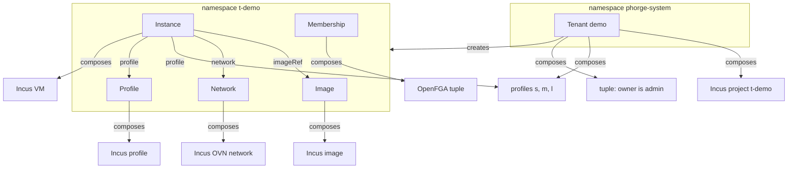

# Phorge API kinds (`phorge.fr/v1alpha1`)

The resources a tenant of the Phorge cloud is made of. They are Crossplane composite resources (XRs) on the `control` cluster. An API, a console or a Terraform provider only has to create, read and delete these; Crossplane turns them into Incus and OpenFGA objects. The schemas are the contract: the source of truth is the XRD in `overlays/control/controllers/crossplane/` (`xrd-*.yml`), this page explains them.

- [Model](#model)
- [Tenant](#tenant)
- [Image](#image)
- [Instance](#instance)
- [Membership](#membership)
- [What a tenant can and cannot do](#what-a-tenant-can-and-cannot-do)
- [Lifecycle and deletion](#lifecycle-and-deletion)
- [Authorization](#authorization)
- [Not done yet](#not-done-yet)

## Model



| Kind | Scope | Lives in |
|---|---|---|
| `Tenant` | Namespaced | `phorge-system` only |
| `Image`, `Network`, `Profile`, `Instance`, `Membership` | Namespaced | the tenant's namespace `t-<name>` only |

A tenant `demo` is the namespace `t-demo` and the Incus project `t-demo`. Creating an `Image`, `Network`, `Profile`, `Instance` or `Membership` anywhere else, or a `Tenant` outside `phorge-system`, fails with `Synced=False` and a message that names the namespace. This guard exists because the namespace is used as the Incus project name: an `Instance` in `default` would otherwise target the real `default` project.

Every kind reports the standard Crossplane conditions (`Synced`, `Ready`). `Ready=True` means every composed resource is up.

## Tenant

The isolation and quota boundary. `metadata.name` is the tenant slug: 2 to 28 characters, lowercase letters, digits and hyphens, starting with a letter.

| Field | Type | Rule |
|---|---|---|
| `spec.owner` | string, required, immutable | Email of the owner, the OIDC claim Incus identifies users by. Gets the Incus `admin` role on the project. To hand a tenant over, add a `Membership` with the `admin` role |
| `spec.displayName` | string | Up to 100 characters. Used as the project description |
| `spec.plan` | enum | `small` (default), `medium`, `large` |
| `status.namespace` | string | `t-<name>` |
| `status.incusProject` | string | `t-<name>` |

Plans, enforced by Incus as project limits:

| Plan | VMs | vCPU | Memory | Disk | Networks |
|---|---|---|---|---|---|
| `small` | 2 | 2 | 4 GiB | 128 GiB | 1 |
| `medium` | 4 | 4 | 8 GiB | 256 GiB | 2 |
| `large` | 6 | 8 | 16 GiB | 512 GiB | 3 |

The CPU, the memory and the disk of each plan hold two instances of its own profile size: `small` two `s`, `medium` two `m`, `large` two `l`. The count of instances is the plan's own (2, 4 and 6), for smaller instances than the profile. The Incus project limit of the disk is the plan disk plus 512 MiB for each VM of the plan (`small` 132096 MiB, `medium` 264192 MiB, `large` 527360 MiB): Incus counts the state of a VM (500 MiB by default) on top of its root disk, so without that margin a VM with the whole plan disk as root, or two `s` on a `small` plan, would be refused. The API checks the plan exactly; Incus stays the second line.

Composes: a Kubernetes namespace, an Incus project, the three profiles `s`, `m` and `l`, and the owner's tuples. Nothing else: **a tenant comes without a network**, the user deploys theirs (see `Network`).

| Profile | vCPU | Memory | Root disk |
|---|---|---|---|
| `s` | 1 | 2 GiB | 64 GiB |
| `m` | 2 | 4 GiB | 128 GiB |
| `l` | 4 | 8 GiB | 256 GiB |

The root disk is on the `remote` pool and part of the profile, so an instance from a profile needs nothing else but its network. The profiles are the tenant's own, created with it. The project also has its own empty `default` profile, which Incus makes. The plan limits above apply to the sum of the instances: the resources of a plan hold two instances of its own profile size, and a profile bigger than what is left (a `l` on a `small` plan, or a third `s` on it) is refused by Incus with the limit it passes (`Reached maximum aggregate value ... limits.disk`).

```yaml
apiVersion: phorge.fr/v1alpha1
kind: Tenant
metadata:
  name: demo
  namespace: phorge-system
spec:
  owner: alice@example.org
  plan: small
```

## Image

An image pulled into the tenant's project. Instances start from an `Image`, never from a bare image name: an instance created from a remote name makes Incus cache that image in the project outside any managed resource, and the project can then no longer be deleted.

| Field | Type | Rule |
|---|---|---|
| `spec.source.name` | string, required | Name on the remote, for example `debian/13/cloud` |
| `spec.source.remote` | string | Default `images` (linuxcontainers.org) |
| `spec.source.type` | enum | `virtual-machine` only (default) |
| `spec.source.architecture` | string | Default `x86_64`, see below |
| `spec.aliases` | list of string | Optional Incus aliases |
| `status.fingerprint` | string | Set once pulled |

The architecture default matters: the Incus provider runs on the arm64 control nodes and Incus otherwise pulls the image for the client's architecture, which no compute node can run. Pulling a VM image takes a few minutes.

## Network

An OVN network the user deploys in the tenant's project, NATed on the `UPLINK`. A tenant has none until the user makes one.

| Field | Type | Rule |
|---|---|---|
| `metadata.name` | string | 1 to 15 characters: lowercase letters, digits and hyphens, starting with a letter (the Incus network name) |
| `spec.description` | string | Up to 200 characters |
| `spec.ipv4` | string | The address of the network and its prefix in the form Incus takes, the gateway's: `10.77.1.1/24`, prefix 16 to 29. Optional, and it can change but not be removed once given. Without it Incus chooses |
| `spec.ipv6` | string | The local IPv6 range, the gateway's address in a unique local range with a `/64` prefix and the host part `::1`: `fd00:7:8:9::1/64`. Optional, and it can change but not be removed once given. Without it Incus chooses a range of its own (every network has one) |
| `status.ipv4` | string | The address that was asked for, empty when Incus chose |
| `status.ipv6` | string | The IPv6 range that was asked for, empty when Incus chose |

It is always NATed: a tenant cannot route its own subnet, and an OVN network without NAT is created in the `Errored` state by Incus on this uplink. Its address is the user's choice (`spec.ipv4`); without one Incus chooses a `/24`. The provider does not report the range Incus chose, so the status only says an address that was asked for; an instance reports its own `status.ipv4`. **Incus does not refuse two networks on the same range** (measured), so what keeps them apart is the API, which checks the overlaps. The plan limits how many networks a tenant has (`small` 1, `medium` 2, `large` 3): the next one is refused by Incus with `Reached maximum number of networks`.

**Changing a range** (measured on the platform, on a network with a running VM): Incus accepts a new `ipv4` or `ipv6` on a network that VMs use, and checks nothing: a global prefix, a `/48` or a range of the router would all be taken, which is why the XRD checks the form of `ipv6` and the API checks the overlaps. The VMs are disturbed differently. After a new `ipv4` they **lose their IPv4 and their gateway** (no route out) until their DHCP client asks again: renewing the lease does not do it, a fresh request does (`networkctl reconfigure` on a systemd-networkd guest, or a restart) and the VM then takes an address of the new range. After a new `ipv6` the VMs take the new prefix from the router advertisement within a minute with no cut, and keep the old address next to it until it expires. A VM that is stopped takes the new range at its next boot. The provider puts back any change made by hand, so the field is the way. A range that was given **cannot be taken out** of the object (the XRD refuses it): measured, Incus keeps the last value when the field goes, and the status would say it chose.

Deleting a `Network` is refused while an instance uses it, see `Instance`.

## Profile

A size the user makes in the tenant's project, next to the three every tenant is created with (`s`, `m` and `l`): CPU, memory and a root disk, in Incus, and optionally the settings of an instance that are not about the network. An instance names it in `spec.profile`.

| Field | Type | Rule |
|---|---|---|
| `metadata.name` | string | 1 to 32 characters: lowercase letters, digits and hyphens, starting with a letter and not ending with a hyphen. `s`, `m`, `l` and `default` are taken |
| `spec.cpu` | integer, required | 1 to 16 |
| `spec.memoryMiB` | integer, required | 256 to 65536 |
| `spec.diskGiB` | integer, required | 1 to 500 |
| `spec.description` | string | Up to 200 characters. Without one it says what the profile comes to |
| `spec.nesting` | boolean | `security.nesting` of the instances that have the profile. No default |
| `spec.secureBoot` | boolean | `security.secureboot` of the instances that have the profile. No default |
| `spec.sshPublicKeys` | list of string, up to 20 | Injected with cloud-init into the instances that have the profile (`cloud-init.user-data`), so their image must be a `cloud` variant. Same shape and same admission rule as on an `Instance` |

A profile never has a network device: it is a size and settings, the network is the instance's (`spec.networks`), and a field for one is refused. The three settings have no default, and a setting the profile does not say is not written in the Incus profile, so the instance's own value, or Incus's default, applies.

An instance takes the settings of its profile and what the instance says itself wins, see `Instance`.

A profile can be changed in place. Deleting one is refused while an instance has it (`in-use by` and the instance's name) and goes by itself once the last instance is gone, without a second delete. Deleting a tenant waits for its profiles, as for its networks and images. A profile above the plan is a definition: it is the instance that Incus refuses, with the plan's limit.

## Instance

A virtual machine in the tenant's project.

| Field | Type | Rule |
|---|---|---|
| `spec.imageRef.name` | string, required | An `Image` of the same tenant |
| `spec.networks` | list of string, 1 to 8 | `Network`s of the same tenant, without duplicate: one NIC each, `eth0`, `eth1`, ... in this order |
| `spec.network` | string | **Deprecated**, the same as `networks` with this one name. Give `networks` or `network`, one of the two |
| `spec.profile` | string | A profile of the tenant (`s`, `m`, `l`, or a `Profile` the user made), which carries the CPU, the memory and the root disk |
| `spec.cpu` | integer | 1 to 16, with `memoryMiB` and `diskGiB`, when there is no profile |
| `spec.memoryMiB` | integer | 256 to 65536, with `cpu` and `diskGiB` |
| `spec.diskGiB` | integer | 1 to 500, with `cpu` and `memoryMiB` |
| `spec.running` | boolean | Default `true` |
| `spec.nesting` | boolean | Allows virtualization or containers inside the VM. No default: see below |
| `spec.secureBoot` | boolean | UEFI secure boot. No default: see below. Some cloud images do not boot with it (`alpine/3.22/cloud`): say `false` for those |
| `spec.sshPublicKeys` | list of string, up to 20 | Injected with cloud-init, so the image must be a `cloud` variant. Each key is checked by the XRD. No default: see below |
| `status.nesting` | boolean | The nesting in force: the instance's, else its profile's, else `false` |
| `status.secureBoot` | boolean | The secure boot in force: the instance's, else its profile's, else `true` |
| `status.sshPublicKeys` | list of string | The keys in force: the instance's, else its profile's, else none |
| `status.state` | string | Incus state, for example `Running` |
| `status.ipv4` | string | Address on the first network |
| `status.networks` | list | The `network`, `ipv4` and `ipv6` of the instance on each network, in the order of `spec.networks` |

The nesting, the secure boot and the SSH keys come from the instance when it says them, else from its profile when that is a `Profile` the user made, else from a default: nesting off, secure boot on, no key. The XRD gives them **no default** on purpose: a default written into every `Instance` would override the profile's, and an absent field is what tells "the instance did not say" from "the instance said `false`" (or an empty list). The composition applies the defaults, and `status.nesting`, `status.secureBoot` and `status.sshPublicKeys` say what is in force. In Incus, an instance takes the key of its profile unless it has the key itself, so the composition writes on the Incus instance only what the instance says (with a profile the user made), and a change of the profile reaches the instances that did not say. Four rules follow:

- Keys given by the instance **replace** the profile's, they do not add to them.
- An empty `sshPublicKeys` list is "no key": the instance then has none of the profile's.
- Without a profile, or with `s`, `m`, `l` (which carry none of these settings), the composition writes the defaults on the Incus instance, as it always did.
- An `Instance` created before the profiles carried settings has the three fields in its `spec`, written by the defaults the XRD then had (`false`, `true`, an empty list). They are what that instance says, so they win over a profile that later gets settings and nothing changes for it. To make such an instance follow its profile, remove the fields (`kubectl patch ... --type merge -p '{"spec":{"nesting":null,"secureBoot":null,"sshPublicKeys":null}}'`).

A size is a profile **or** the three custom values, never both and never neither: the XRD refuses the others (`give a profile or cpu, memoryMiB and diskGiB, not both`, `without a profile, cpu, memoryMiB and diskGiB are all required`). There are no defaults. A profile that does not exist, or that does not fit the plan, leaves the instance `Synced=False` with Incus's message. A size can be changed in place, from custom values to a profile or back, on a stopped instance.

The networks of a running instance can be changed in place, and the instance is neither stopped nor restarted (measured on a Debian cloud image): a network added to the list appears as a new NIC in the guest within about 20 seconds, and a network taken out of the list loses its NIC within about 6 seconds and its `Usage` goes with it. A hot-plugged NIC is `down` in the guest until the guest configures it (the image's own network setup runs at boot, so a restart brings it up); the instance's other NICs are not touched. The NICs are named after the position in the list, so removing a network that is not the last renames what follows it after the next boot.

A `Network` that an instance uses cannot be deleted, whichever of its networks it is: each network of an instance has a `Usage` of its own, so the request is refused with `in-use by` and the instance's name, and the `Network` goes by itself once the last instance is gone, without a second delete.

The per-instance bounds are the XRD's. The plan's totals are enforced on top by the project: a third VM on a `small` tenant is refused by Incus with `Reached maximum number of instances`, and the instance stays `Synced=False` with that message.

## Membership

Gives a user or a group a role on the tenant. The tenant is the namespace the `Membership` lives in.

A `Membership` cannot be edited: changing the subject or the role is refused. An OpenFGA tuple cannot be changed in place and the provider refuses to destroy one, so an edit would leave the old right granted while everything reads `Ready`. Delete the `Membership` and create another.

| Field | Type | Rule |
|---|---|---|
| `spec.subject.kind` | enum, required | `User` or `Group` |
| `spec.subject.name` | string, required | The user's email, or the group name |
| `spec.role` | enum, required | `admin`, `operator`, `user`, `viewer` |

A `Membership` writes two OpenFGA tuples:

| Store | Tuple | Why |
|---|---|---|
| `iaas` (the one Incus authorizes against) | the subject is `user` of the Incus project for the roles `admin`, `operator` and `user`, and `viewer` for the role `viewer` | The Incus role `user` sees the project and may open a terminal or the console of its instances (the terminal of the API, [decision 0013](../decisions/0013-the-api-exchanges-the-token-of-a-user-for-incus.md)); it creates, changes and deletes nothing, so the Incus UI (`iaas.phorge.fr`) stays read-only for changes. Crossplane owns every Incus object and reconciles back anything changed by hand. The right is on the project: provider-openfga cannot write an object that contains a slash, which every instance (`instance:<project>/<name>`) is |
| `phorge-api` | the subject has the real role on `tenant:<name>` | This is what the Phorge API checks before it writes |

The relation of a tuple cannot change in place: the provider refuses to destroy a `RelationshipTuple` that a new relation would replace (`lifecycle.prevent_destroy`), and the tuple stays `Synced=False`. To move existing tuples to a new relation, delete the composed `RelationshipTuple` of each (`t-<tenant>-owner`, `i-<hash>`) once: the composition makes it again with the relation it now says.

| Role | Meaning for the API |
|---|---|
| `admin` | Everything on the tenant, including memberships, renaming it and deleting it |
| `operator` | Manage instances, images, networks and profiles (and read the rest) |
| `user` | Create and use instances |
| `viewer` | Read-only. Networks are read with any role, written with `operator` and `admin`; no key scope covers them yet |

There is one `Membership` per subject in a tenant: the tuples are named after a hash of the subject, so a second `Membership` for the same user or group (with any role) is not composed and stays `Ready=False`, instead of silently sharing, and on deletion removing, the tuple of the first. To change a role, delete the `Membership` and create another. A `Membership` for the tenant's owner is refused: the owner already has the `admin` role from the `Tenant`.

Like every kind that lives in a tenant namespace, it is only composed if a `Tenant` of that name exists in `phorge-system`: a namespace named `t-<x>` created by hand gets nothing, so it cannot be used to grant rights on a future tenant.

## ApiKey

A service account of Authentik that holds a key, for a person's scripts and tools (OpenTofu, CI, a CLI): the key is exchanged for a token (`client_credentials`) and the API accepts that token as the OpenFGA subject `apikey:<status.identity>`. It belongs to a user, not to a tenant, so every `ApiKey` lives in the namespace `phorge-keys`.

| Field | Type | Rule |
|---|---|---|
| `spec.owner` | email, required, immutable | The user the key belongs to. Recorded by the API from the token of the person who creates it |
| `spec.grants` | list, required | One entry per tenant (`tenant`, a name, once), each with its `scopes`, a non-empty set among `tenants:read`, `instances:read\|write`, `images:read\|write`, `memberships:read\|write` |
| `spec.expiresAt` | date-time, required, immutable | From this date OpenFGA refuses the key. A key is not extended: create another |
| `spec.displayName` | string | At most 100 characters |
| `status.keyId` | string | The name of the object |
| `status.identity` | string | The user name of the service account, `apikey-<name>`, also the OpenFGA subject |
| `status.secretName` | string | The Secret that receives the key, `<name>-token`, in `phorge-keys` |
| `status.expired` | boolean | True once `expiresAt` has passed |

**A key is only what OpenFGA holds for it.** The composition writes one tuple per tenant and scope in the `phorge-api` store (`key_<resource>_<action>` on `tenant:<name>`), each with the condition `not_expired` and `expires_at` in its context, and the API sends the current time with every question. From `expiresAt` OpenFGA refuses the key by itself, at the second and without anything being deleted. A key has no groups, so it is never a platform administrator: it cannot create a tenant for someone else nor choose a plan. The scopes are `tenants:read|write`, `instances:read|write`, `images:read|write`, `networks:read|write`, `profiles:read|write` and `memberships:read|write`; `tenants:write` renames the tenant it is given on and deletes it.

**The identity does not expire.** The service account and its token are created in Authentik by a `provider-http` `Request`, with an identity that can only add users and manage tokens (`blueprint-crossplane.yml`). The key is generated by Authentik and lands in the Secret `status.secretName`; the Request owns that Secret. The API shows the key once and deletes the Secret, after which provider-http recreates it empty, so a Secret without a `token` means the key was already handed over.

**Deleting an `ApiKey`** deletes the account in Authentik with its token, the Secret, and the tuples: nothing is left behind. The identity of Crossplane may delete the accounts it created and no other user (the initial permissions of `blueprint-crossplane.yml`: authentik gives its role `delete_user` and `view_user` on each user it creates, and on nothing else). The account is named after the key and the id of a key is never reused. If the token is deleted in Authentik by hand, the `Request` cannot create it again and stays `Ready=False`: delete the `ApiKey` and make another. The accounts that earlier keys left behind are removed with [a command](../how-to/remove-the-account-of-a-deleted-api-key.md).

**Who manages keys.** Only a person signed in with Authentik: a key cannot create, read, or delete keys, and one never exceeds what its creator holds on the tenants it names (the API checks that when it creates the object). For now only the platform administrators create them; anyone lists and revokes their own.

## What a tenant can and cannot do

The project is deny-by-default: `restricted=true` and every `restricted.*` key set explicitly, so a changed default in a later Incus release cannot silently open something.

| Allowed | Blocked |
|---|---|
| VMs, with optional nesting | Containers (`limits.containers=0`) |
| Disks on the `remote` pool, managed NICs | GPU, PCI, USB, proxy, infiniband, unix devices |
| Several OVN networks, up to the plan, on the `UPLINK` | Choosing a cluster node (placement is Incus's) |
| Data volumes, snapshots, backups | Forwards and load balancers (no public exposure yet) |
| Images through the `Image` kind | Custom image upload |

Traffic from a tenant leaves through the `comp-ns` VLAN. The router drops traffic between Phorge networks (`drop-phorge-to-phorge` in the Network repository), so tenants reach the Internet but not the other VLANs. That is enforced by the router, not by Incus.

## Lifecycle and deletion

- **Delete in the foreground.** Deleting an XR in the default (background) mode removes the object at once while its composed resources and the Incus objects last for up to a minute or two: a `Tenant` was gone after 1 s, its resources after 58 s. With `propagationPolicy: Foreground` (`kubectl delete --cascade=foreground`) the object stays until everything it composed is gone, so its absence is a real completion signal. An API should always delete this way and treat "not found" as "deleted".
- **An `Instance` whose first start failed is stuck and must be deleted and created again.** Incus creates the VM, the start then fails (for instance "incompatible with secureboot", see `spec.secureBoot`), and the provider keeps the resource as failed: every later reconcile wants to destroy and recreate it, which `prevent_destroy` refuses. `status.problems` then shows the original error as well as the `prevent_destroy` one.
- **An `Image` used by an `Instance` cannot be deleted.** The request is refused with an "in-use" message that counts the usages. The refusal is remembered and replayed: the `Image` goes by itself, a few seconds after the last `Instance` that uses it, without a second delete.
- `status.problems` on every kind says what is wrong with the composed resources (the Incus or OpenFGA error), empty when everything is up. `Ready` now needs the composed resources to be `Ready` **and** `Synced`.

- Deleting an `Instance` or an `Image` removes the Incus object.
- Deleting a `Tenant` while it still holds an `Image`, an `Instance` or a `Membership` makes it wait, `Deleting`, until they are gone: a `Usage` composed by each of them keeps the tenant's namespace. Kubernetes deletes the content of a terminating namespace, including what the providers need to reach Incus and OpenFGA, so an object still in a namespace that terminates could never be deleted and would hold the tenant for ever. Delete the children first (the API does: instances, memberships, images, then the tenant), then the namespace goes, then the network, the profile, the tuple, and finally the project. Incus refuses to delete a non-empty project, so the project is retried until its contents are gone. The projects are never force-destroyed.
- Deleting a `Tenant` destroys the VMs it contains. An API should ask for confirmation.

## Authorization

Users authenticate with Authentik (OIDC). Incus identifies them by the `email` claim, so the email is the key of every tuple, and the Authentik enrollment flow must make it mandatory. Tuples are written by Crossplane in two OpenFGA stores:

- `iaas` (`overlays/control/resources/openfga/store.yml`): the one Incus enforces. Users and groups are `user` there (`viewer` for the role `viewer`): they see the project and may open a terminal, and the Incus UI is read-only for changes for everybody, the tenant owner included. Crossplane reconciles an Incus object back as soon as it is changed by hand, and a VM deleted in Incus is recreated blank.
- `phorge-api`: the roles the Phorge API checks (`can_read_*`, `can_write_*`). Writing goes through the API. An API key writes nothing there: it acts as its owner.

No users or groups are stored in Crossplane: Authentik owns identities.

## Not done yet

- **`Expose`** (publishing an instance), forward address blocks per tenant.
- **Image source restriction.** `restricted.images.servers` cannot be set: the provider sends the image server without a scheme and Incus refuses every pull. The `Image` kind is the only gate.
- **Network addressing.** Tenant networks get the subnet Incus picks (`ipv4.address: auto`), which Incus is relied on to keep distinct from its other networks. It knows nothing of the router VLANs, so a subnet inside `10.1` to `10.5` or `10.10` to `10.12` is possible, if unlikely: the e2e suite checks it, nothing prevents it. The provider only returns the keys that were declared, not the address Incus picked, so a `Tenant` cannot check it itself: whatever creates tenants should read `ipv4.address` of the `default` network from Incus once the tenant is `Ready`, and recreate the tenant if it lands in one of those ranges.
- **Per-tenant network isolation inside a tenant, ACLs, metering.**
